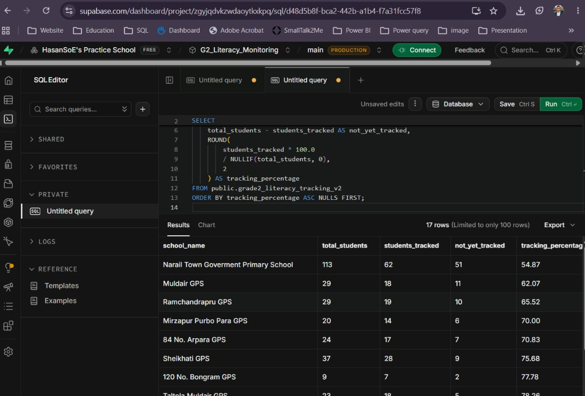
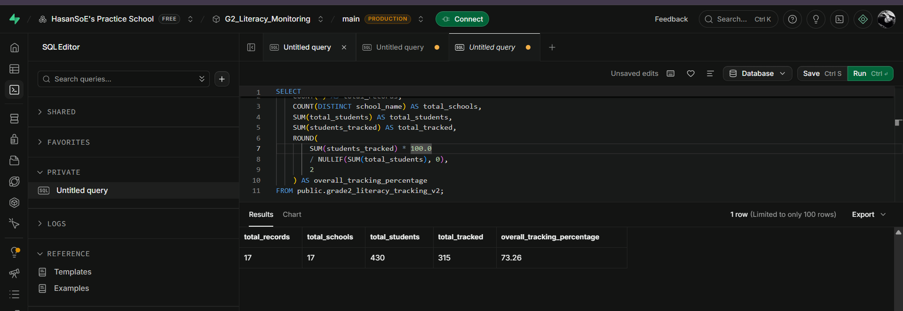
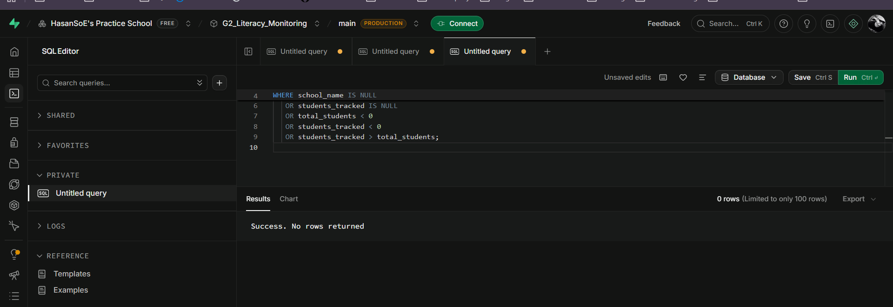
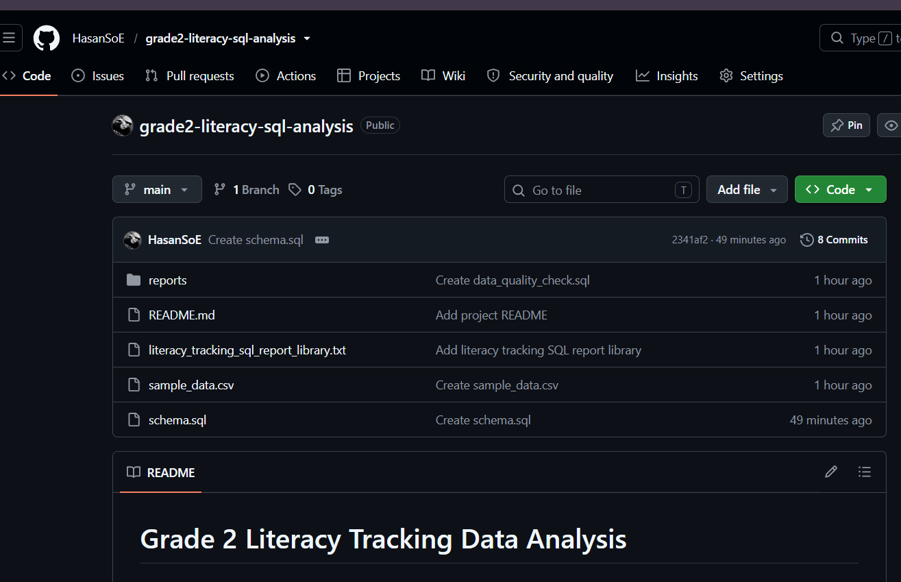

# Grade 2 Literacy Tracking Data Analysis

## Project Overview
This project uses SQL and PostgreSQL (Supabase) to analyze
Grade 2 literacy tracking data for school monitoring and reporting.

## Objectives
- Analyze school-wise student tracking.
- Calculate student tracking percentages.
- Identify schools that may need follow-up.
- Check missing values and possible data quality issues.
- Prepare summary indicators for monitoring reports.

## Tools Used
- SQL
- PostgreSQL
- Supabase
- GitHub

## SQL Skills Practiced
- SELECT, WHERE, ORDER BY, LIMIT
- COUNT, SUM, AVG, MIN, MAX
- GROUP BY and HAVING
- CASE statements
- NULL handling and NULLIF
- Common Table Expressions (CTEs)
- Window functions and ranking
- Data quality checks

## Example Analysis
The project includes queries to calculate:
- Total student records
- School-wise tracking percentages
- Schools below a selected tracking target
- Missing and inconsistent data
- Summary indicators for reporting

## Data Privacy
Only approved or anonymized data should be used.
No student names, personal information, passwords, or API keys
should be published in a public repository.

## Author
SQL learner | Literacy Facilitator | Education Data Analysis

## Project Screenshots

### 1. Tracking Percentage Report

### 2. School Summary

### 3. Data Quality Check

### 4. GitHub Repository

